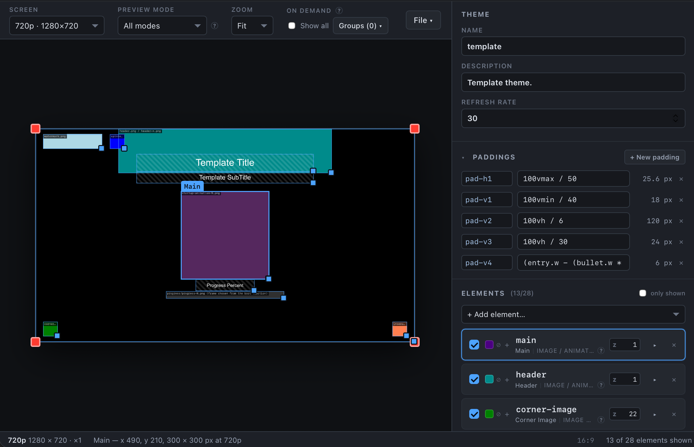
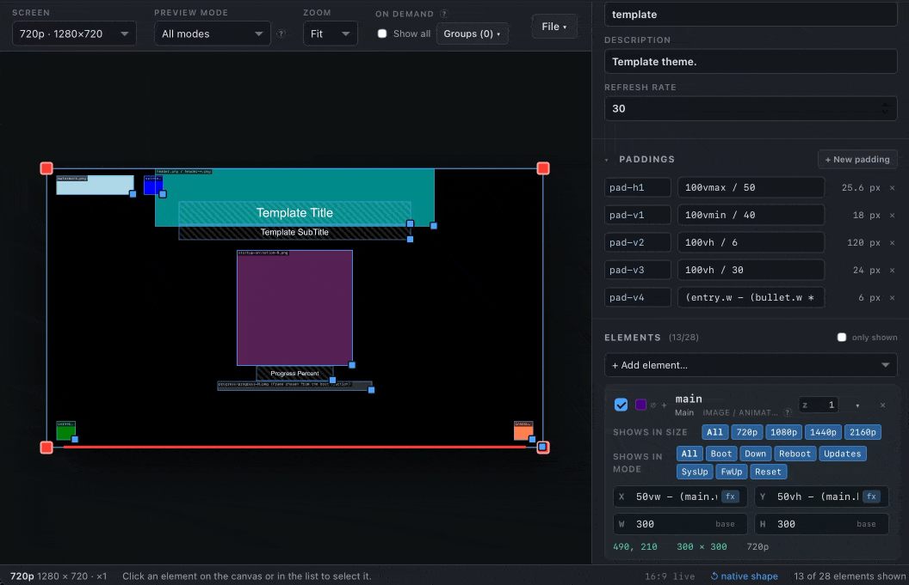
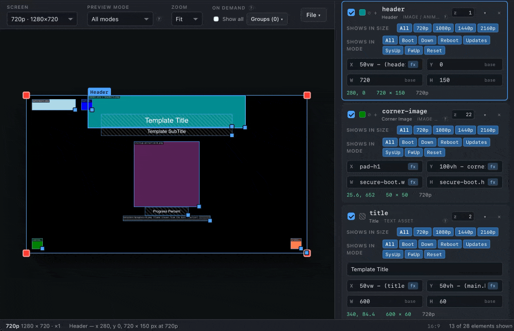

# Plymion

**A visual editor for Plymouth boot themes.** Arrange a boot splash on a live canvas, drop in your own artwork, and generate a complete installable theme.

 

Plymouth themes are normally written by hand in a small scripting language, with no way to see the result short of rebooting. Plymion replaces that loop with a live preview rendered from the same numbers the generated theme will use, so what you arrange is what boots.

Plymion is built around the idea that a theme should describe **relationships, not pixels**. Plymion handles and keeps value expressions in the generated script instead of flattening them to coordinates, so one theme can adapt to any aspect ratio resolution rather than needing a copy per screen size. Four are modelled side by side, and every element can be shown or hidden per size and per boot mode.

*Live resizing of the all visual elements*

Artwork is whatever you have: PNG, JPEG, GIF and SVG are accepted and become the PNGs Plymouth needs. Animated GIFs and SMIL-animated SVGs expand into frame sequences, and a single frame is simply a still. Each asset is measured and filed under the size tier closest to its native size, and a tier with no art of its own falls back to a smaller one — so a missing file degrades to a smaller image instead of drawing nothing.

## How To Use

Extract the repo contents to its own folder, and run the `index.html` file in a web browser. 

*Undo demo of Header fill*

**Tips**
* Saving saves progress to a single `.plymeta` file
* You can export the theme as a folder or a zip, or write it straight to disk
* Any image item in the theme with no asset provided will use the html fill colour from the live view
* Undo and redo edits using the menu or keyboard shortcuts
* Saves deliberately cary no history

#### AI Notice
I totally vibe coded this in the background while doing other stuff. This was a fun side project while I focused on other things, and I barely touched the code myself at all. The ideas are still mine, but the code for this project... yah have no clue what is going on in there other than a few vague directions I gave. This cost me about $3 to make with deepseeek across multiple sessions on a weekend.

